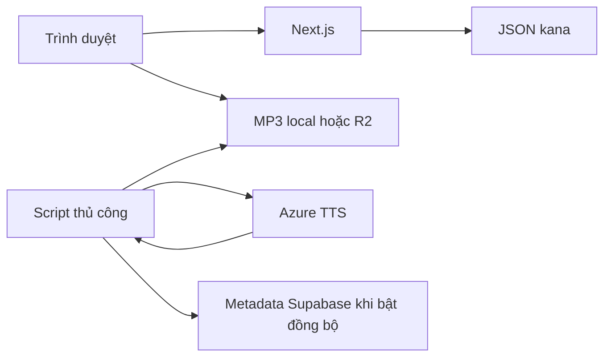

# Basic Design giai đoạn 1 — 基本設計

Baseline 28/10/2026 để triển khai local, chưa phải nghiệm thu. Yêu cầu: KANA-01/02/03, thiết bị/font/hiệu năng trong 01. Quy tắc UI theo 12.

## Phạm vi

Khách xem Hiragana/Katakana, nghe và luyện gõ romaji không cần tài khoản. Mỗi hệ có 46 chữ cơ bản, 20 âm đục, 5 âm nửa đục, 33 âm ghép. Chưa gồm âm ghép ngoại lai như ティ, thứ tự nét, đăng ký công khai, lưu điểm hoặc đồng bộ tiến độ.

Next.js/React/TypeScript/Tailwind là nền ứng dụng. Supabase là đích database/Auth; kana ở giai đoạn này đọc JSON cùng mã nguồn, không cần cloud để mở trang và luyện. MP3 sinh trước là audio chuẩn; giọng Nhật của thiết bị chỉ là dự phòng có thông báo rõ khi chưa cấu hình MP3.



## Màn hình

| ID | URL | Bố cục và hành vi |
|---|---|---|
| S01 | `/` | Giới thiệu, nút Bảng chữ cái, link luyện, mẫu chữ thật và hướng dẫn |
| S02 | `/kana` | Chọn hệ; bảng cơ bản/đục/nửa đục 5 cột; âm ghép 3 cột; chi tiết chữ và nút phát lại |
| S03 | `/kana/practice` | Chọn hệ/nhóm/số câu, câu hỏi, phản hồi, tổng kết và luyện lại câu sai |
| C01 | `/sources` | Nguồn dữ liệu, font và tình trạng audio |

Header chung có tên Masu, link Bảng chữ cái/Luyện tập, trạng thái trang; footer có nguồn dữ liệu. Có skip link và focus bàn phím nhìn rõ.

```text
S02 desktop:
Tiêu đề / hướng dẫn
[Hiragana] [Katakana]           [Luyện hệ chữ này]
Bảng chữ (5 cột)               Chi tiết chữ đã chọn
Âm đục / nửa đục               Chữ lớn / romaji / nghe lại
Âm ghép (3 cột)                Trạng thái audio
```

Ở 360px, chi tiết nằm trên bảng, các nhóm xếp dọc, không cuộn ngang. Kana dùng Klee One, romaji nhỏ hơn. Ô trống や/わ không focus được. Chọn chữ có viền rõ, không chỉ đổi màu. Đổi hệ dừng audio và xóa lựa chọn, không tự phát lúc tải trang.

S03 mặc định Hiragana/cơ bản/10 câu, có lựa chọn 10/20/toàn bộ; nhận query script từ S02. Không chọn nhóm thì không bắt đầu được. Bắt đầu thay cấu hình bằng phiên luyện. Không có nút phát âm trước khi trả lời để tránh gợi ý. Sau khi chấm mới cho nghe và xem cách đọc đúng.

## Quy tắc và ngoại lệ

| Thao tác | Kết quả |
|---|---|
| Chọn kana | Hiện chữ/cách đọc, phát audio; dừng nguồn trước |
| Audio lỗi/không có giọng Nhật | Báo rõ, cho thử lại, không chặn luyện |
| Gửi câu rỗng | Yêu cầu nhập, không tính lượt |
| Gửi romaji | Chấm ngay; hiện đúng/sai và đáp án, khóa tới câu kế |
| Enter khi đã chấm | Chuyển câu kế, không cộng kết quả trùng |
| Hết phiên | Tổng đúng, danh sách sai, luyện lại lỗi hoặc cấu hình phiên mới |
| Tải lại trang | Phiên trong bộ nhớ kết thúc; hướng dẫn nêu rõ chưa lưu tiến độ |

Chuẩn hóa NFKC/lowercase/trim; không bỏ khoảng trắng giữa. Chấp nhận biến thể được khai báo, như shi/si, chi/ti, tsu/tu, fu/hu. ぢ/づ chấp nhận ji/di và zu/du; を nhận wo/o; ん nhận n/nn/n'. Không tự suy diễn ngoài dataset. Giảng viên cần nghe duyệt audio, nhất là ký tự đứng riêng và trợ từ.

## Dữ liệu, quyền và nghiệm thu

Không thu thập tên/email hoặc lưu điểm. Khách không đọc bảng Supabase. Migration nền được chuẩn bị nhưng không tự áp dụng cloud. Khóa dịch vụ chỉ ở script/server.

Đối chiếu [checklist](../testing/phase-1.md). Local phải chạy không có khóa cloud, đủ dataset, phiên không lặp, dùng bàn phím/360px và xử lý audio lỗi. Azure/R2 thật, Safari, máy chiếu và 4G cần bằng chứng riêng trước nghiệm thu hoàn chỉnh.
