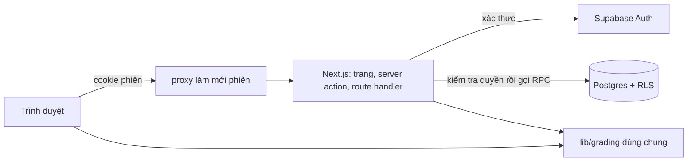

# Basic Design giai đoạn 3 — Bài tập và lớp học

Baseline 28/10/2026. Giai đoạn 1–2 vẫn chờ cloud/thiết bị/giảng viên duyệt; thiết kế này cho phép phát triển và kiểm chứng trên Supabase local, không đánh dấu các giai đoạn trước đã nghiệm thu. Yêu cầu nguồn: AUTH-01, CLASS-01..05/07, EX-01/02/03/06/07/09, VOCAB-01..04, DATA-01..03 trong 01; hợp đồng dữ liệu 03 và chấm/nộp 07.

## Phạm vi

Học viên tự đăng ký, xác nhận email, vào lớp bằng mã, làm bài luyện/kiểm tra dạng trắc nghiệm và điền từ, xem kết quả theo chính sách phản hồi, ôn từ vựng/sổ lỗi bằng FSRS và xem tiến độ. Giảng viên (role do người vận hành cấp) tạo lớp, chọn bài/phiên bản/lịch mở, giao bài, đóng bài, xem bảng theo dõi, câu sai nhiều và xuất CSV.

Ngoài phạm vi: ghép đôi/sắp xếp/nghe trên UI làm bài (schema và hàm chấm đã có, UI ở giai đoạn 5–6), editor bài học, email nhắc, lưu nháp bài giao trước khi xuất bản, xóa tài khoản tự phục vụ, chia sẻ bài giữa giảng viên.

Tính năng lớp cần SUPABASE_URL, SUPABASE_PUBLISHABLE_KEY và SUPABASE_SECRET_KEY. Thiếu cấu hình thì kana/bài học công khai vẫn chạy; các trang tài khoản/lớp báo "chưa được kích hoạt", không có phiên giả. Lớp luôn đọc bài/phiên bản từ database, độc lập với LESSON_SOURCE của danh mục công khai.

## Màn hình

| ID | URL | Hành vi chính |
|---|---|---|
| A01 | /sign-up | Họ tên, email, mật khẩu ≥ 8; luôn tạo học viên; gửi email xác nhận |
| A02 | /verify-email | Hướng dẫn mở email, gửi lại thư xác nhận; không tiết lộ email đã tồn tại |
| A03 | /sign-in | Đăng nhập chung học viên/giảng viên; giữ đích `next` nội bộ |
| A04 | /forgot-password, /reset-password | Gửi link đặt lại (thông báo giống nhau dù email có hay không), đặt mật khẩu mới sau khi mở link |
| A05 | /join-class | Nhập mã; chưa đăng nhập thì chuyển đăng nhập/đăng ký rồi quay lại với mã đã nhập; một lần bấm xác nhận để vào |
| S17 | /classes | Danh sách lớp đang tham gia, bài tập sắp hạn |
| S18 | /classes/[id] | Bài đã mở theo thứ tự (đọc, trình chiếu, flashcard) và bài tập kèm trạng thái |
| S07 | /vocabulary/[lessonId] | Flashcard lật thẻ, nghe; đã đăng nhập thì chấm 4 mức để đưa vào lịch ôn |
| S08 | /review | Số thẻ đến hạn hôm nay; thẻ từ vựng tự đánh giá, thẻ lỗi phải trả lời lại; tổng kết và chuỗi ngày học |
| S11 | /assignments/[id] | Thông tin bài, bắt đầu/tiếp tục lượt; một câu một màn hình trên điện thoại, nhiều câu trên máy tính; trạng thái lưu, mất mạng, hết hạn, xung đột |
| S12 | /assignments/[id]/results | Kết quả lượt đã nộp theo chính sách phản hồi |
| S13 | /mistakes | Câu từng sai, đáp án/giải thích khi được phép, chuỗi đúng x/3, đã giải quyết |
| S14 | /progress | Ba chỉ số tách riêng: tiến độ đọc, điểm bài tập, thẻ ôn; chuỗi ngày học |
| T01 | /teach | Lớp của tôi, bài tôi sở hữu, lối vào tạo lớp |
| T02 | /teach/classes | Danh sách và form tạo lớp (tên, điểm đạt lớp) |
| T03 | /teach/classes/[id] | Bốn ô thống kê, bảng học viên/nhãn, câu sai ≥ 50%, bài giao, mã lớp, CSV |
| T04 | /teach/classes/[id]/students/[uid] | Kết quả từng bài (lượt mới nhất) và câu đúng/sai của một học viên |
| T05 | /teach/classes/[id]/assign | Nội dung lớp (bài, phiên bản, thứ tự, lịch mở) và form giao bài practice/test |

Header có liên kết tài khoản lấy qua API nhẹ để trang tĩnh (kana, bài công khai) vẫn tĩnh. Trang chủ khi đã đăng nhập hiện số thẻ cần ôn và bài sắp hạn. Ở 360px các bảng giảng viên chuyển thành danh sách, không cuộn ngang trang.

## Luồng chính

1. **Đăng ký và vào lớp:** nhập mã ở /join-class → đăng ký → mở email xác nhận → quay lại /join-class với mã → bấm "Vào lớp" → S18. Mã sai hiện cùng một thông báo, không tiết lộ lớp; thử sai liên tiếp bị tạm khóa. Tài khoản giảng viên không vào lớp như học viên.
2. **Chuẩn bị lớp:** giảng viên tạo lớp, thêm bài mình sở hữu với phiên bản đã xuất bản, thứ tự và available_at. Có thể nâng phiên bản cho lớp; bài đã giao giữ phiên bản cũ.
3. **Giao bài:** chọn bài trong lớp, practice (chọn câu luyện choice/fill của phiên bản đang ghim) hoặc test (nhập câu riêng choice/fill), hạn nộp, nộp muộn, điểm đạt, số lượt, chính sách phản hồi. Hộp xác nhận nêu rõ điều kiện và đề không sửa được sau xuất bản; xuất bản chụp snapshot câu hỏi. Sau đó chỉ đổi tiêu đề hoặc đóng bài (cảnh báo số lượt đang làm sẽ không nộp được).
4. **Làm bài:** S11 không tự tạo lượt khi mở/tải trang; bấm bắt đầu mới tạo hoặc tiếp tục lượt. Practice chấm từng câu ngay (câu đã kiểm tra bị khóa), test không chấm. Draft lưu lên server sau khi đổi câu trả lời và khi chuyển câu; "Đã lưu" chỉ hiện khi server xác nhận. Nộp cho phép câu trống sau khi xác nhận số câu trống.
5. **Kết quả:** practice và test after_submit thấy điểm/đúng sai/giải thích sau khi nộp; test after_due chỉ thấy xác nhận đã nộp và thời điểm đến hạn công bố. Câu sai vào sổ lỗi; lỗi của test chỉ mở khi được xem đáp án.
6. **Ôn tập:** S08 lấy thẻ đến hạn của chính học viên; thẻ lỗi trả lời lại và đúng ba lượt ôn liên tiếp thì giải quyết, sai thì mở lại chuỗi.
7. **Theo dõi:** T03 tính nhãn khi mở trang (bỏ bài → chưa đạt → yếu nghe → đạt; chưa có dữ liệu). Câu sai nhiều chỉ dùng lượt nộp mới nhất của mỗi học viên. CSV chỉ của lớp đó.

## Ngoại lệ và trạng thái

| Tình huống | Kết quả |
|---|---|
| Chưa đăng nhập vào trang lớp/bài/ôn | Chuyển /sign-in?next=đường dẫn hiện tại |
| Học viên mở trang giảng viên | 403/không thấy dữ liệu; không lộ tồn tại lớp khác |
| Học viên lớp khác mở bài giao/lượt làm | 404, API không trả dữ liệu |
| Chưa tới available_at, bài đóng, lớp ngừng | Không bắt đầu được, nêu lý do |
| Quá hạn, không cho nộp muộn | Không bắt đầu/lưu/nộp; draft được giữ để giải thích |
| Hết lượt | Không tạo lượt mới; xem lượt đã nộp theo chính sách |
| Hai tab | Bắt đầu đồng thời chỉ một lượt; lưu bằng revision cũ báo xung đột, yêu cầu tải bản mới |
| Mất mạng | Giữ bản chưa đồng bộ trên máy theo user/lượt, báo "chưa lưu"; có mạng thì so revision rồi gửi |
| Nộp hai lần / timeout | Một lần chấm; lần sau trả kết quả cũ theo quyền xem |
| Email chưa xác nhận | Không đăng nhập được, có nút gửi lại thư |
| Link email hết hạn/sai | Báo rõ, cho gửi lại; không đăng nhập một phần |

## Quyền

Theo ma trận 03. Học viên không đọc trực tiếp bảng lớp/bài giao/lượt làm; mọi dữ liệu qua trang server hoặc API đã lọc. Giảng viên chỉ thấy lớp mình tạo và học viên trong lớp đó. Không ai tự sửa role/điểm. Snapshot, điểm và nhật ký ôn do server ghi trong transaction.

## Điều kiện nghiệm thu

Truy vết tại [checklist giai đoạn 3](../testing/phase-3.md). Local cần chạy trọn luồng với một giảng viên, hai học viên thuộc hai lớp khác nhau trên Supabase local: vượt quyền bị từ chối, test không lộ đáp án/kết quả trước hạn, nộp trùng chấm một lần, hai tab và mất mạng giữ đúng draft, sửa bài không đổi snapshot, nhãn/thống kê/CSV đúng 07. Supabase cloud, email thật (SPF/DKIM), backup/khôi phục thử và lớp học thật là điều kiện nghiệm thu riêng.
