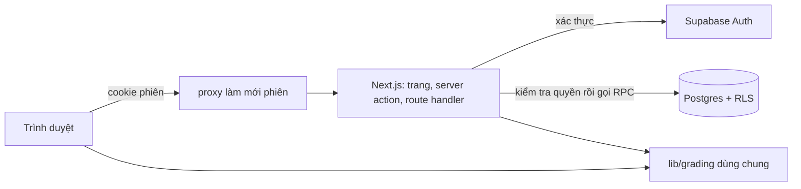

# Basic Design giai đoạn 3 — Bài tập và lớp học

> Phạm vi nền Nhật: tài liệu giai đoạn này giữ thiết kế/bằng chứng triển khai trước dịch vụ Việt–Trung; không chứng minh tính năng mới đã có. Thiết kế hiện hành xem [BD dịch vụ](../basic-design/teaching-service.md), [DD dịch vụ](../detail-design/teaching-service.md) và [checklist dịch vụ](../testing/teaching-service.md). Kết quả PASS/Chưa chạy lịch sử được giữ nguyên.

> Tài liệu này mô tả nền lớp học đã triển khai với role student/teacher hiện tại. Yêu cầu dịch vụ ngày 29/10/2026 bổ sung đăng ký giáo viên, vừa học vừa dạy và chia sẻ theo [BD dịch vụ](../basic-design/teaching-service.md); chưa triển khai. Kết quả AUTH-01 cũ chỉ chứng minh luồng cấp quyền thủ công, không phải onboarding giáo viên mới.

Baseline 28/10/2026. Giai đoạn 1–2 vẫn chờ cloud/thiết bị/giảng viên duyệt; thiết kế này cho phép phát triển và kiểm chứng trên Supabase local, không đánh dấu các giai đoạn trước đã nghiệm thu. Yêu cầu nguồn: AUTH-01, CLASS-01..05/07, EX-01/02/03/06/07/09, VOCAB-01..04, DATA-01..03 trong 01; hợp đồng dữ liệu 03 và chấm/nộp 07.

## Phạm vi

Học viên tự đăng ký, xác nhận email, vào lớp bằng mã, làm bài luyện/kiểm tra dạng trắc nghiệm và điền từ, xem kết quả theo chính sách phản hồi, ôn từ vựng/sổ lỗi bằng FSRS và xem tiến độ. Giảng viên (role do người vận hành cấp) tạo lớp, chọn bài/phiên bản/lịch mở, giao bài, đóng bài, xem bảng theo dõi, câu sai nhiều và xuất CSV.

Ngoài phạm vi: ghép đôi/sắp xếp/nghe trên UI làm bài (schema và hàm chấm đã có, UI ở giai đoạn 5–6), editor bài học, email nhắc, lưu nháp bài giao trước khi xuất bản, xóa tài khoản tự phục vụ, chia sẻ bài giữa giảng viên.

Tính năng lớp cần SUPABASE_URL, SUPABASE_PUBLISHABLE_KEY và SUPABASE_SECRET_KEY. Thiếu cấu hình thì kana/bài học công khai vẫn chạy; các trang tài khoản/lớp báo "chưa được kích hoạt", không có phiên giả. Lớp luôn đọc bài/phiên bản từ database, độc lập với LESSON_SOURCE của danh mục công khai.

## Màn hình

| ID | URL | Hành vi chính |
|---|---|---|
| A01 | /sign-up | Họ tên, email, mật khẩu ≥ 8; luôn tạo học viên; gửi email xác nhận |
| A02 | /verify-email | Hướng dẫn mở email, gửi lại thư xác nhận; không tiết lộ email đã tồn tại |
| A03 | /sign-in | Đăng nhập chung học viên/giảng viên; giữ đích `next` nội bộ |
| A04 | /forgot-password, /reset-password | Gửi link đặt lại (thông báo giống nhau dù email có hay không), đặt mật khẩu mới trong 1 giờ sau khi mở link; đăng nhập bằng mật khẩu không mở được form này |
| A05 | /join-class | Nhập mã; chưa đăng nhập thì chuyển đăng nhập/đăng ký rồi quay lại với mã đã nhập; một lần bấm xác nhận để vào |
| S17 | /classes | Danh sách lớp đang tham gia, bài tập sắp hạn |
| S18 | /classes/[id] | Bài đã mở theo thứ tự (đọc, trình chiếu, flashcard) và bài tập kèm trạng thái |
| S07 | /vocabulary/[lessonId] | Flashcard lật thẻ, nghe; đã đăng nhập thì chấm 4 mức để đưa vào lịch ôn. Thẻ theo phiên bản lớp đang học (link mang `?version=`), không đổi theo bản giáo viên mới xuất bản |
| S08 | /review | Số thẻ đến hạn hôm nay (tối đa 50 thẻ/phiên, báo khi còn thẻ cho phiên sau); thẻ từ vựng tự đánh giá, thẻ lỗi phải trả lời lại; tổng kết và chuỗi ngày học |
| S11 | /assignments/[id] | Thông tin bài, bắt đầu/tiếp tục lượt; một câu một màn hình trên điện thoại, nhiều câu trên máy tính; trạng thái lưu, mất mạng, hết hạn, xung đột |
| S12 | /assignments/[id]/results | Kết quả lượt đã nộp theo chính sách phản hồi |
| S13 | /mistakes | Câu từng sai, đáp án/giải thích khi được phép, chuỗi đúng x/3, đã giải quyết |
| S14 | /progress | Ba chỉ số tách riêng: tiến độ đọc, điểm bài tập, thẻ ôn; chuỗi ngày học; biểu đồ điểm bài tập 8 tuần; tóm tắt lịch sử Sheet của chính mình nếu có |
| T01 | /teach | Lớp của tôi, bài tôi sở hữu, lối vào tạo lớp |
| T02 | /teach/classes | Danh sách và form tạo lớp (tên, điểm đạt lớp) |
| T03 | /teach/classes/[id] | Bốn ô thống kê (ô đầu là tỉ lệ nộp bài tuần này), bảng học viên/nhãn, câu sai ≥ 50%, bài giao kèm điểm TB và số học viên đã nộp, mã lớp, CSV |
| T04 | /teach/classes/[id]/students/[uid] | Kết quả từng bài (lượt mới nhất) và câu đúng/sai của một học viên |
| T05 | /teach/classes/[id]/assign | Nội dung lớp (bài, phiên bản, thứ tự, lịch mở) và form giao bài practice/test |

Header có liên kết tài khoản lấy qua API nhẹ để trang tĩnh (kana, bài công khai) vẫn tĩnh. Trang chủ khi đã đăng nhập hiện số thẻ cần ôn và bài sắp hạn. Ở 360px các bảng giảng viên chuyển thành danh sách, không cuộn ngang trang.

## Luồng chính

1. **Đăng ký và vào lớp:** nhập mã ở /join-class → đăng ký → mở email xác nhận → quay lại /join-class với mã → bấm "Vào lớp" → S18. Mã sai hiện cùng một thông báo, không tiết lộ lớp; thử sai liên tiếp bị tạm khóa. Tài khoản giảng viên không vào lớp như học viên.
2. **Chuẩn bị lớp:** giảng viên tạo lớp, thêm bài mình sở hữu với phiên bản đã xuất bản, thứ tự và available_at. Có thể nâng phiên bản cho lớp; bài đã giao giữ phiên bản cũ.
3. **Giao bài:** chọn bài trong lớp, practice (chọn câu luyện choice/fill của phiên bản đang ghim) hoặc test (nhập câu riêng choice/fill), hạn nộp, nộp muộn, điểm đạt, số lượt, chính sách phản hồi. Hộp xác nhận nêu rõ điều kiện và đề không sửa được sau xuất bản; xuất bản chụp snapshot câu hỏi. Sau đó chỉ đổi tiêu đề hoặc đóng bài (cảnh báo số lượt đang làm sẽ không nộp được).
4. **Làm bài:** S11 không tự tạo lượt khi mở/tải trang; bấm bắt đầu mới tạo hoặc tiếp tục lượt. Practice chấm từng câu ngay (câu đã kiểm tra bị khóa), test không chấm. Draft lưu lên server sau khi đổi câu trả lời và khi chuyển câu; "Đã lưu" chỉ hiện khi server xác nhận. Nộp cho phép câu trống sau khi xác nhận số câu trống.
5. **Kết quả:** practice và test after_submit thấy điểm/đúng sai/giải thích sau khi nộp; test after_due chỉ thấy xác nhận đã nộp và thời điểm đến hạn công bố. Câu sai vào sổ lỗi; lỗi của test chỉ mở khi được xem đáp án.
6. **Ôn tập:** S08 lấy thẻ đến hạn của chính học viên; thẻ lỗi trả lời lại và đúng ba lượt ôn liên tiếp thì giải quyết, sai thì mở lại chuỗi.
7. **Theo dõi:** T03 tính nhãn khi mở trang (bỏ bài → chưa đạt → yếu nghe → đạt; chưa có dữ liệu). Câu sai nhiều chỉ dùng lượt nộp mới nhất của mỗi học viên. CSV chỉ của lớp đó.

## Ngoại lệ và trạng thái

| Tình huống | Kết quả |
|---|---|
| Chưa đăng nhập vào trang lớp/bài/ôn | Chuyển /sign-in?next=đường dẫn hiện tại |
| Học viên mở trang giảng viên | 403/không thấy dữ liệu; không lộ tồn tại lớp khác |
| Học viên lớp khác mở bài giao/lượt làm | 404, API không trả dữ liệu |
| Chưa tới available_at, bài đóng, lớp ngừng | Không bắt đầu được, nêu lý do |
| Quá hạn, không cho nộp muộn | Không bắt đầu/lưu/nộp; draft được giữ để giải thích |
| Hết lượt | Không tạo lượt mới; xem lượt đã nộp theo chính sách |
| Hai tab | Bắt đầu đồng thời chỉ một lượt; lưu bằng revision cũ báo xung đột, yêu cầu tải bản mới |
| Mất mạng | Giữ bản chưa đồng bộ trên máy theo user/lượt, báo "chưa lưu"; có mạng thì so revision rồi gửi |
| Nộp hai lần / timeout | Một lần chấm; lần sau trả kết quả cũ theo quyền xem |
| Email chưa xác nhận | Không đăng nhập được, có nút gửi lại thư |
| Link email hết hạn/sai | Báo rõ, cho gửi lại; không đăng nhập một phần |

## Quyền

Theo ma trận 03. Học viên không đọc trực tiếp bảng lớp/bài giao/lượt làm; mọi dữ liệu qua trang server hoặc API đã lọc. Giảng viên chỉ thấy lớp mình tạo và học viên trong lớp đó. Không ai tự sửa role/điểm. Snapshot, điểm và nhật ký ôn do server ghi trong transaction.

## Điều kiện nghiệm thu

Truy vết tại [checklist giai đoạn 3](../testing/phase-3.md). Local cần chạy trọn luồng với một giảng viên, hai học viên thuộc hai lớp khác nhau trên Supabase local: vượt quyền bị từ chối, test không lộ đáp án/kết quả trước hạn, nộp trùng chấm một lần, hai tab và mất mạng giữ đúng draft, sửa bài không đổi snapshot, nhãn/thống kê/CSV đúng 07. Supabase cloud, email thật (SPF/DKIM), backup/khôi phục thử và lớp học thật là điều kiện nghiệm thu riêng.

## Furigana trong bài tập — 05/11/2026

- Học viên chưa đọc được kanji (lớp N5) thấy cách đọc phía trên chữ Hán ở đề, lựa chọn, đoạn văn, mảnh sắp xếp, giải thích và lời nghe, khi giáo viên viết `{漢字|かんじ}` như ở trang đọc bài. Áp dụng khi làm bài, ở phản hồi Kiểm tra câu này, trang kết quả, lịch sử bài hằng ngày, sổ lỗi và các trang của giáo viên.
- Không đặt furigana lên chữ đang hỏi cách đọc và không dùng trong đáp án học viên gõ: Reng từ chối xuất bản và nói câu nào cần sửa.
- Bài đã giao giữ nguyên nội dung lúc giao. Furigana có từ bài giao tạo sau khi lớp dùng phiên bản mới của bài nguồn ([DD](../detail-design/phase-3.md#furigana-trong-bài-tập--05112026)).

## Sửa lỗi hiển thị bài đã giao — 05/11/2026

- Giáo viên mở bài đã giao (kể cả bài luyện hằng ngày) từ trang lớp (Xem câu hỏi, sửa lỗi hiển thị). Trang là bảng gọn mỗi câu một dòng, lọc được câu có chữ Hán chưa có cách đọc và câu đã sửa. Bấm **Sửa** ở câu cần sửa để mở hai cột **Trước | Sau**: sửa đề bài, giải thích, và gõ cách đọc vào ô cạnh từng chữ Hán (gõ romaji tự ra hiragana), không phải gõ ký hiệu furigana. Đáp án, lựa chọn, điểm, loại câu và thứ tự câu không đổi được; chữ của lựa chọn, mảnh câu, đoạn văn và lời nghe chỉ thêm hoặc bỏ furigana.
- Câu trả lời học viên đang làm, lượt đã nộp và điểm giữ nguyên; học viên mở lại bài là thấy nội dung mới.
- Mỗi lần sửa lưu nội dung trước và sau; trang hiện "Đã sửa N lần" kèm đề trước/sau.
- Sửa trong bài giao không đổi bài nguồn: muốn các bài giao sau không lặp lỗi thì sửa cả bài nguồn rồi xuất bản ([DD](../detail-design/phase-3.md#sửa-lỗi-hiển-thị-bài-đã-giao--05112026)).

## Tự nộp lượt còn mở khi hết hạn — 05/11/2026

- Bài **không cho nộp muộn**: học viên đã bắt đầu làm nhưng chưa bấm Nộp (đóng trang, mất mạng trước khi đồng hồ tự nộp) thì khoảng 6:00 sáng sau hạn Reng nộp các câu đã lưu và chấm như bài nộp tay; giờ nộp ghi bằng hạn nộp, không tính muộn.
- Lượt làm lại khi học viên đã có một lượt nộp trước không bị nộp, để giữ điểm cũ. Nháp không đọc được thì bỏ qua, không thành 0 điểm. Học viên đã rời lớp, lớp đã lưu trữ và bài cho nộp muộn không thuộc việc này.
- Trang kết quả của học viên ghi "Reng tự nộp lúc hết hạn … với các câu đã lưu"; trang chi tiết học viên của giáo viên ghi "(học viên chưa bấm Nộp)" ([DD](../detail-design/phase-3.md#tự-nộp-lượt-còn-mở-khi-hết-hạn--05112026)).

## Tin nhắn giao bài cho nhóm lớp — 06/11/2026

- Lớp nhận bài qua nhóm Zalo/Messenger. Giao bài xong, thông báo "Đã giao «…»" ở trang lớp có nút **Sao chép tin nhắn cho nhóm lớp**; mỗi bài còn mở trong mục Bài đã giao có nút **Sao chép tin nhắn giao bài** để nhắc lại. Lớp tự học không có nút.
- Tin nhắn có tên lớp, loại bài và tên bài, hạn nộp theo giờ Việt Nam (có cho nộp muộn hay không) và link bài; đề thi thử JLPT ghi thêm số phút và hạn bắt đầu thi.
- Trình duyệt chặn clipboard thì Reng hiện sẵn đoạn tin nhắn để chép tay. Link chỉ mở được với học viên trong lớp; người chưa đăng nhập được đưa qua trang đăng nhập rồi quay lại ([DD](../detail-design/phase-3.md#tin-nhắn-giao-bài-cho-nhóm-lớp--06112026)).

## Thi thử JLPT — 09/11/2026

Mục tiêu: học viên lớp tiếng Nhật làm đề N5/N4 có cấu trúc và thời gian như đề thật trước kỳ thi 06/12/2026.

- **Giáo viên** mở trang Giao bài của lớp tiếng Nhật, mục **Thi thử JLPT**: chọn cấp N5 hoặc N4, bài nguồn (ngân hàng ôn của lớp), tên đề, số phút (mặc định N5 90, N4 115), **Mở đến** (hạn bắt đầu thi) và lúc công bố điểm. Reng xem trước số câu từng phần (chữ Hán – từ vựng, ngữ pháp – đọc hiểu, nghe hiểu), báo khi bài nguồn có ít câu hơn đề thật, và ưu tiên câu chưa ra ở các đề trước của lớp.
- **Học viên** làm một lượt, không nộp muộn. Đồng hồ chạy từ lúc bấm **Bắt đầu thi** và vẫn chạy khi đóng trang; hết giờ trang tự nộp. Đã đóng trang thì Reng nộp các câu đã lưu khi học viên mở lại đề hoặc khoảng 6:00 sáng hôm sau. Trang đề và trang kết quả đếm ngày tới kỳ JLPT tiếp theo.
- **Kết quả** có số câu đúng từng phần và điểm ước tính thang 180: kiến thức ngôn ngữ và đọc hiểu quy về 120, nghe hiểu về 60; đỗ khi tổng đạt 80 (N5) hoặc 90 (N4) và hai phần đạt sàn 38 và 19. Thiếu phần nghe thì không ước tính. Đây chỉ là ước tính: điểm thật tính theo độ khó từng câu.
- **Câu nghe trong đề** dùng file audio công khai của bài nguồn như bài luyện tập; lời nghe không gửi tới trình duyệt trước khi nộp. Đây là ngoại lệ có chủ ý so với [phạm vi giai đoạn 5](phase-5.md#phạm-vi) (câu nghe trong bài test cần phân phối audio riêng có thời hạn): đề thi thử là để luyện, nên chấp nhận việc học viên có thể nghe lại file ngoài giới hạn lượt. Bài kiểm tra có điểm thật vẫn cần cách phân phối riêng.
- **Nghe một lần** (10/11/2026): như đề thật, mỗi câu nghe trong đề thi thử chỉ phát một lần, chạy hết không dừng, không lùi và không nghe chậm; trang đề dặn đọc câu hỏi và lựa chọn trước khi bấm Nghe. Bài luyện tập, bài hằng ngày và bài kiểm tra thường giữ trình phát đầy đủ.
- **Giờ gợi ý từng phần** (10/11/2026): dưới đồng hồ chung hiện phần mà đề thật đang làm theo thời gian đã trôi (N4 25/55/35 phút, N5 20/40/30 phút, chia theo tỉ lệ nếu giáo viên đổi số phút), thời gian còn lại của phần đó và nút **Đến câu …** để sang phần sau. Chỉ là gợi ý: không khóa phần đã qua, đồng hồ chung vẫn quyết định lúc nộp.
- **Đề chính thức** (11/11/2026): giáo viên có thể chọn bài nguồn là đề chính thức JLPT (公式問題集 第二集 2018 trên jlpt.jp; N5 91 câu, N4 98 câu). Đề lấy đủ mọi câu theo đúng thứ tự trong sách, cấp và tên theo bài, không gắn tháng/năm vì sách không ghi kỳ thi.
  - Học viên chỉ gặp câu hỏi trong đề thi thử: bài nguồn mở cho học viên sau ngày thi thật.
  - Câu hỏi có hình (tranh lựa chọn, tờ thông tin), từ được hỏi có gạch chân như sách, mỗi trang ghi nguồn jlpt.jp.
  - Phần nghe đọc lại nguyên văn script chính thức bằng giọng máy, trang kết quả có link tới bản ghi âm gốc trên jlpt.jp.
  - Lời giải thích tiếng Việt do Reng viết. Nguồn và quyền dùng ở [báo cáo](../testing/jlpt-official-sources-2026-11-11.md).
- Chi tiết dữ liệu, quyền và cách chọn câu ở [DD](../detail-design/phase-3.md#thi-thử-jlpt--09112026).
