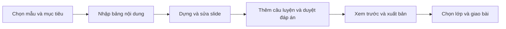

# Basic Design — Dịch vụ hỗ trợ giảng dạy

Bổ sung ôn N4 (02/11/2026): theo lựa chọn mở rộng toàn bộ N4 của người học, lớp tự học của Việt ghim bộ **Tổng ôn N4 — Minna 1–50**, 200 câu/80 từ; mỗi ngày 40 câu, mỗi nhóm kanji/biến đổi từ/ngữ pháp/đọc hiểu 10 câu. Bộ Minna 1–28 (200 câu/40 từ) vẫn được giữ riêng, các bài đã giao giữ phiên bản nguồn cũ. Cron chọn câu đã có, không tự sinh nội dung AI. Thẻ từ vựng bắt đầu lịch ôn sau lần học/đánh giá đầu; câu sai vào lịch ôn sau nộp bài. Chưa có phần nghe. Xem [kiểm chứng và phần bổ sung](../testing/n4-review-bank.md).

Ngày: 29/10/2026. Trạng thái: đang triển khai theo lát; tiến độ ghi ở [đối chiếu source](../source-alignment.md). Phạm vi theo yêu cầu người dùng: nhiều giáo viên, hỗ trợ mở rộng nhiều môn/ngôn ngữ, ưu tiên dạy tiếng Trung cho người Việt (Việt–Trung), lớp học riêng, Google Meet bên ngoài, học liệu chia sẻ và chuyển bài scan.

## Đánh giá hướng sản phẩm

Hướng này phù hợp với nền hiện có: editor và renderer dùng chung dữ liệu; lớp/bài giao/điểm/nhắc học có thể tái sử dụng. Phần khó nhất là quyền giữa giáo viên và chất lượng nhập scan. Ưu tiên vận hành được một lớp trước, sau đó thêm chia sẻ và OCR. Không cần dựng hạ tầng video để đạt mục tiêu dạy online.

Google Meet hỗ trợ trình bày tab/cửa sổ theo [hướng dẫn chính thức](https://support.google.com/meet/answer/9308856?hl=en). Chọn tab slide cho học sinh xem; cửa sổ presenter/đáp án và dashboard giữ riêng. Kiểm tra âm thanh trên thiết bị thật. Link Meet không thay thế kiểm tra quyền lớp của Reng; quyền vào cuộc gọi do Google Meet quản lý.

## Phân biệt với mã nguồn hiện tại

| Hạng mục | Có thể tái sử dụng | Phần cần bổ sung |
|---|---|---|
| Tài khoản | Auth, xác minh email, role phía server | Tự đăng ký giáo viên; khả năng vừa học vừa dạy |
| Lớp | Chủ lớp, mã lớp, thành viên, bài giao | Giới hạn chỗ, link Meet, UI mời học sinh |
| Học liệu | Nháp, xuất bản, snapshot, trình chiếu, PDF | Ngôn ngữ Trung, chia sẻ phiên bản và sao chép |
| Bài tập | Choice/fill, server chấm, policy test, báo cáo | Upload scan, duyệt OCR; chấm tay chưa có |
| Nhắc học | Tùy chọn opt-in, lịch, job email | Phạm vi/quota theo giáo viên; nghiệm thu gửi thật |

Không đổi nhãn trạng thái của checklist cũ thành PASS cho chức năng mới.

## Luồng 1 — Giáo viên mở lớp 10 học sinh

1. Chọn đăng ký giáo viên, xác minh email và chấp nhận điều kiện dùng dịch vụ. Server kiểm tra trước khi bật khả năng dạy. Người đã là học sinh có thể bổ sung khả năng dạy mà không mất bài cũ.
2. Tạo lớp: tên, ngôn ngữ, sức chứa 10, ngưỡng đạt, link Meet tùy chọn. Mã lớp/lời mời là quyền xin vào lớp, không cấp quyền quản trị.
3. Mười học sinh có email xác minh vào lớp; mỗi người chỉ chiếm một chỗ. Người thứ 11 thấy lớp đã đầy; join lại cùng tài khoản trả thành công, không chiếm thêm chỗ. Danh sách chờ chưa làm bản đầu.
4. Giáo viên thu hồi/đổi mã, đóng nhận thành viên, cho học sinh rời lớp; thành viên đã rời không đọc được tài nguyên riêng mới. Không xóa lịch sử điểm để giải phóng chỗ.
5. Giáo viên gắn phiên bản bài vào lớp, đặt thời điểm mở, giao bài và hạn nộp. Học sinh chỉ xem tài nguyên được cấp cho lớp mình.

## Luồng 2 — Dạy qua Meet và học trên Reng

Trang lớp có lịch/link buổi học và học liệu. Bản đầu giáo viên nhập link Meet thủ công, mở bằng tab mới. Giáo viên chia sẻ tab slide, học sinh vừa nghe Meet vừa mở bài/bài tập trên Reng. Học sinh tự chuyển trang khi đọc lại; đồng bộ slide từ xa là chức năng riêng chưa cam kết. Không gửi ghi chú riêng vào slide chia sẻ, HTML học sinh, PDF hoặc dữ liệu phiên trình chiếu.

Sau giờ học, học sinh làm/nộp bài; hệ thống chấm khách quan và công bố theo policy. Dashboard phân biệt chưa nộp, đang làm, đã nộp, chờ chấm nếu dạng chấm tay được triển khai. Nhắc học dùng lựa chọn người nhận; giáo viên không tự bật đồng ý nhận email thay học sinh.

## Luồng 3 — Chia sẻ giữa giáo viên

Chủ bài chọn phiên bản đã xuất bản, giáo viên nhận (tài khoản đã xác minh) và quyền `view` hoặc `copy`. Mặc định riêng tư, không có chợ học liệu công khai trong bản đầu. Người nhận xem trước bài được chia sẻ; quyền copy cho phép tạo một bài mới sở hữu bởi người nhận và sửa độc lập. Quyền view chưa cho gắn bài gốc vào lớp của người nhận; muốn dạy lớp mình cần copy.

Gói chia sẻ chỉ gồm slide, nội dung tham chiếu và media được phép sử dụng. Không kèm học sinh, báo cáo, nháp, ghi chú giáo viên hay câu test riêng. Câu quiz trong slide là câu luyện đã công khai cho người nhận, không được coi là đề bí mật. Bản sao giữ thông tin tác giả/nguồn/điều kiện dùng; người nhận không được chia sẻ tiếp trừ khi quyền nguồn cho phép.

Thu hồi ngăn xem/sao chép mới từ nguồn; không tự xóa bản sao đã được cấp hợp lệ hay thay đổi bài đã giao. Hệ thống phải giải thích điều này trước khi cấp quyền copy. Gỡ nội dung vi phạm là luồng vận hành riêng, có audit và thông báo, không hứa thu hồi được mọi tệp đã tải.

## Luồng 4 — Từ ảnh bài tập sang trang tương tác

1. Giáo viên tải ảnh JPG/PNG hoặc PDF scan, xác nhận có quyền dùng. Bản đầu đề xuất tối đa 10 trang, 20 MB/job, cấu hình lại được sau thử nghiệm.
2. Hệ thống kiểm tra tệp, hiển thị trang gốc và chạy nhận dạng ở nền. Tiến trình/lỗi rõ ràng; giáo viên có thể tiếp tục công việc khác.
3. Editor hiển thị ảnh cạnh câu nhận dạng, vùng ảnh nguồn và phần còn thiếu. Giáo viên sửa câu hỏi, lựa chọn, thứ tự, ký hiệu, điểm và đáp án; kiểm tra chữ Hán, pinyin/thanh điệu, kana/furigana riêng.
4. Bản đầu hỗ trợ chữ in và câu choice/fill. Bảng phức tạp, chữ viết tay, nối hình, tự luận có thể giữ làm hình minh họa hoặc nhập tay; không báo đã tự chấm được.
5. Chỉ câu được giáo viên duyệt và đủ đáp án mới xuất bản được. Chuyển thành schema bài tập hiện có, sau đó giao cho lớp bằng luồng thông thường. OCR không tự tạo assignment.

Hai mức giá trị: ảnh trong slide giúp chiếu/đọc; bài tương tác cần dữ liệu câu hỏi và đáp án. Chỉ nhúng ảnh không đủ để chấm tự động. AI có thể gợi ý cấu trúc/đáp án nhưng mọi gợi ý phải được xác nhận, không lấy độ tin cậy OCR làm bằng chứng đáp án đúng.

## Màn hình dự kiến

| Mã | Màn hình/route dự kiến | Hành vi chính |
|---|---|---|
| SV01 | `/sign-up/teacher` | Đăng ký và trạng thái xác minh/khả năng dạy |
| SV02 | `/teach/classes/[id]` (form cài đặt lớp) | Sức chứa, ngôn ngữ, link Meet, mã lớp |
| SV03 | Trang lớp học sinh hiện có | Link buổi học, slide đã mở, bài và tiến độ |
| SV04 | `/teach/library` | Bài của tôi/được chia sẻ, ngôn ngữ và nguồn |
| SV05 | `/teach/lessons/[id]/sharing` | Chọn version, người nhận, quyền, thu hồi |
| SV06 | `/teach/imports`, `/teach/imports/[id]` | Upload, tiến trình, ảnh và câu draft, duyệt |
| SV08 | `/admin`, `/admin/teachers`, `/admin/activity` | Quản trị: tổng quan, duyệt/tạm dừng giáo viên, hạn thuê, cài đặt duyệt, nhật ký |
| SV09 | `/for-teachers` | Trang giới thiệu công khai cho giáo viên, tối ưu SEO |
| SV10 | `/guide` | Hướng dẫn sử dụng công khai cho giáo viên, học viên và quản trị viên; link ở thanh đầu trang, chân trang, trang Giảng dạy và Lớp của tôi |
| SV11 | `/teach/lessons/[id]/starter` | So sánh bản nháp với bài mẫu mới nhất và thay nội dung nháp bằng mẫu |
| SV12 | `/self-study` | Tự học: bài học công khai và công cụ luyện tập theo từng môn, không cần tài khoản |
| SV13 | `/pinyin`, `/pinyin/practice` | Tự học tiếng Trung: bảng pinyin (thanh điệu, thanh mẫu, vận mẫu, đặt dấu) và luyện gõ pinyin có dấu, gõ được số thanh |

SV01–SV05, SV08–SV13 đã có; kích hoạt giảng dạy cho tài khoản đang đăng nhập ở `/teach/start`, thư viện chia sẻ ở `/teach/library`, cấp/thu hồi quyền ở `/teach/lessons/[id]/sharing`. SV06 (scan) là route đề xuất, chưa tồn tại. UI 360px; review scan trên desktop có hai cột, mobile chuyển tab ảnh/câu. Bảo toàn sửa tay khi retry nhận dạng.

## Ngôn ngữ và chấm điểm

MVP tập trung Việt–Trung: học sinh Việt Nam học tiếng Trung, giao diện/hướng dẫn/nghĩa bằng tiếng Việt, nội dung học có chữ Hán, pinyin và audio tiếng Trung. Không yêu cầu giáo viên nhập một khóa tiếng Nhật để nghiệm thu dịch vụ. Tiếng Việt ở đây là ngôn ngữ hướng dẫn, không mặc định một khóa dạy tiếng Việt riêng. Các môn và ngôn ngữ khác mở sau theo nhu cầu.

Tiếng Nhật giữ kana, kanji, wanakana và quy tắc hiện tại. Tiếng Trung cần metadata `zh-Hans`/`zh-Hant`, pinyin và chế độ nhập Unicode/IME; không ép wanakana, không tự đổi giản/phồn hoặc bỏ thanh điệu. Giáo viên khai báo đáp án tương đương. Bộ font/TTS đúng locale, module kana/JLPT chỉ xuất hiện cho tiếng Nhật. UI quản lý ban đầu vẫn tiếng Việt.

Tự luận/ảnh bài làm cần chấm tay và trạng thái/điểm riêng trước khi bật; ngoài MVP scan choice/fill. Không tự coi nội dung chưa hỗ trợ là sai hoặc điểm 0.

## Thứ tự giao và tiêu chí thử nghiệm

A: onboarding giáo viên + cách ly dữ liệu + lớp có sức chứa/link Meet. B1: luồng soạn Việt–Trung theo mẫu và dạy thử một bài nhập môn. B2: chia sẻ/copy version và dùng lại bài, giữ tương thích nội dung Nhật hiện có. C: upload ảnh để xem, sau đó OCR choice/fill có duyệt. D: chấm tay và mở rộng loại scan theo dữ liệu thực tế. Chưa triển khai thu phí.

Thử với hai giáo viên tiếng Trung dạy người Việt, một lớp 10 học sinh, một lớp khác để kiểm tra vượt quyền; kiểm tra hồi quy riêng với dữ liệu Nhật hiện có; dùng bộ scan được phép sử dụng. Đo thời gian nhập tay và thời gian sửa kết quả scan, tỷ lệ câu cần sửa, lỗi đáp án, chi phí/trang và số job lỗi. Chỉ mở OCR rộng khi giúp giáo viên tiết kiệm thời gian và mọi câu xuất bản được duyệt. Testcase chi tiết ở [checklist dịch vụ](../testing/teaching-service.md).

## Luồng 5 — Giáo viên tự soạn bài theo mẫu

Đặc tả thao tác đầy đủ tại [biên soạn nội dung](../content-authoring.md). Đã có bản local (wizard 5 bước, dựng slide từ bảng, xác nhận đáp án, xuất bản riêng tư); editor chi tiết cũ vẫn dùng cho bài tiếng Nhật. Chưa có TTS web, dùng lại/sao chép bài và thử với giáo viên thật.

Giáo viên soạn chuyên môn; Reng cung cấp bố cục và bộ bài minh họa có người chuyên môn duyệt. Bộ mẫu đầu gồm buổi đầu làm quen, từ mới, hội thoại và ôn tập. Có dùng lại bài của mình và copy bài được chia sẻ đúng quyền; không cần upload scan mới tạo bài được.

Màn hình soạn mới (SV07, mở rộng trang tạo/sửa bài hiện có) có 5 bước với nhãn tiếng Việt, nút quay lại/tiếp tục, lưu nháp ở mọi bước, không ép hoàn thành trong một phiên. Bảng nội dung có chữ Hán/pinyin/nghĩa Việt/ví dụ, hỗ trợ dán Excel. Mã kỹ thuật ẩn khỏi luồng cơ bản. Desktop xem nội dung cạnh preview, mobile chuyển qua lại mà không mất dữ liệu. Giáo viên vẫn có thể mở phần chỉnh slide chi tiết.

Mẫu khởi đầu đi theo mục tiêu nhỏ và thứ tự từ dễ đến khó; bài đầu được bỏ phần ôn cũ. Bước luyện tập gợi ý khung choice/fill nhưng giáo viên duyệt đáp án. Bước cuối tách lưu nháp, xuất bản và giao lớp; chỉ trình chiếu thì không cần giao bài. Khi dùng lại/chuyển mẫu/dựng lại phải thấy thay đổi trước xác nhận, không ghi đè sửa tay.

Trước OCR, thử trọn luồng với một giáo viên, một bài nhập môn Việt–Trung và lớp thực tế. Mục tiêu dưới 30 phút khi đã chuẩn bị nội dung; ghi thời gian và điểm vướng, chưa coi là đạt trước đo. Tiêu chí hồi quy quyền nhiều giáo viên vẫn theo bộ thử dịch vụ chung.

## Luồng 6 — Dạy tiếng Nhật theo trình tự Minna no Nihongo (pilot, đã có bản local)

Cập nhật 29/10/2026 theo yêu cầu người dùng: pilot ưu tiên dạy tiếng Nhật cho người Việt bằng slide đi theo trình tự bài Minna no Nihongo, không mở rộng thêm tính năng ngoài luồng dạy học. Luồng Việt–Trung vẫn chạy.

1. Giáo viên có tài khoản đã xác minh và quyền dạy (tự đăng ký có quản trị viên duyệt, hoặc cấp trên Supabase local bằng `npm run seed:local -- --email … --name …`).
2. Ở `/teach/lessons/new`, giáo viên chọn một bài từ 1 đến 15 trong bộ bài mẫu tự biên soạn, kiểm tra/sửa trong editor rồi xuất bản; bài vẫn riêng tư cho lớp. Bài sau dùng bản sao hoặc soạn mới.
3. Tạo lớp (mặc định tiếng Nhật), gắn phiên bản bài, giao luyện tập. Trong buổi Meet, giáo viên chiếu slide theo nhịp Minna: từ vựng → bảng đếm → mẫu câu → ví dụ → luyện thay thế (ẩn câu mẫu, bấm hiện từng hàng) → câu hỏi → hội thoại (ẩn nghĩa từng lượt); presenter giữ ghi chú riêng.
4. Học viên tự đăng ký, xác minh email, vào lớp bằng mã; đọc bài có furigana, hội thoại, bảng; ôn bằng slide/flashcard; làm bài, xem điểm và giải thích; giáo viên xem báo cáo lớp.
5. Bài luyện hằng ngày (tùy chọn theo lớp): giáo viên chọn 5/7/10/15/20/30/40/60 câu (60 câu cho lớp ôn theo ngân hàng nhập từ Google Sheet; số câu khác trong khoảng 3–60 đặt khi nhập ngân hàng vẫn hiện đúng trong ô chọn) và bài nguồn ở ô "Lấy câu từ". Mỗi sáng từ 6:00 giờ Việt Nam (cron Hobby có thể lệch trong vòng 1 giờ) Reng tự giao một bài luyện tập lấy câu từ bài nguồn đã chọn, ví dụ ngân hàng ôn; thêm bài mới vào lớp không đổi nguồn này. Để "Tự động" thì lấy bài mới nhất đã mở có câu chọn/điền/sắp xếp (bài mới chỉ có slide thì lấy bài trước đó); bài đã chọn chưa mở hoặc không có câu chọn/điền/sắp xếp thì tạm dùng quy tắc tự động và trang lớp báo rõ. Trang lớp hiện bài đang dùng và số câu, cảnh báo khi bài nguồn có ít câu hơn số câu mỗi ngày (khi đó ngày nào học viên cũng gặp lại toàn bộ câu). Hạn 23:59 cùng ngày, nộp muộn vẫn được, tối đa 3 lượt, xem giải thích ngay. Câu đổi mỗi ngày, ưu tiên câu chưa xuất hiện trong 14 ngày gần nhất; câu sai vào sổ lỗi và lịch ôn tập như bài thường. Nút "Giao bài hôm nay ngay" tạo bài của ngày khi cần; mỗi lớp chỉ có một bài cho mỗi ngày. Báo cáo chỉ tính bài được giao sau khi học viên vào lớp. Từ 03/11/2026 câu sắp xếp (bấm mảnh theo thứ tự) cũng được giao; câu đọc hiểu có đoạn văn riêng được chọn và hiện liền nhau, mỗi câu có nhãn phần (Kanji, Chữ Hán, Pinyin, Ngữ pháp, Đọc hiểu…). Các tính năng làm bài dùng chung cho lớp tiếng Nhật và tiếng Trung; lớp tiếng Trung có thêm "Luyện chữ Hán" (pinyin, nhận mặt chữ, nghĩa) tương ứng "Luyện kanji".

Nội dung mẫu không sao chép văn bản, tranh hay audio của sách; chỉ đi theo chủ điểm và trình tự bài. Chi tiết thao tác ở [biên soạn](../content-authoring.md), kết quả kiểm thử ở [nghiệm thu](../testing/teaching-service.md).

## Luồng 7 — Vừa dạy vừa học: lớp tự học, nhật ký buổi dạy và cập nhật bài mẫu (02/11/2026)

Bối cảnh pilot: một giáo viên vừa dạy học viên N5 theo Minna, vừa tự ôn JLPT N4. Nguyên tắc: **một tài khoản, tách vai bằng lớp**. Tư cách học đến từ việc là thành viên lớp; quyền dạy đến từ việc sở hữu lớp. Không cần tài khoản thứ hai, lịch sử học tập không bị chia đôi.

| Lớp | Vai của giáo viên | Thành viên | Báo cáo |
|---|---|---|---|
| Lớp dạy (mặc định) | Chủ lớp, không bao giờ là học viên | Học viên vào bằng mã/link | Chỉ tính học viên; chủ lớp không chiếm chỗ, không vào điểm trung bình, CSV hay thống kê câu sai |
| Lớp tự học | Chủ lớp kiêm học viên duy nhất | Chỉ chủ lớp, tự thêm khi tạo lớp | Là kết quả của chính giáo viên |

1. **Lớp tự học.** Ở `/teach/classes`, chọn "Lớp tự học của tôi" khi tạo lớp. Lớp có một chỗ, không có mã mời hay link mời; ai khác nhập mã cũ cũng chỉ thấy "mã không đúng". Bài giao và bài luyện hằng ngày của lớp đến chính giáo viên ở Lớp của tôi; câu sai vào sổ lỗi và lịch ôn của giáo viên như học viên thường. Trang Giảng dạy ghi "lớp tự học của bạn"; email tóm tắt lớp bỏ qua lớp tự học.
2. **Không tự vào lớp mình dạy (CR-20).** Nhập mã lớp mình đang dạy trả thông báo hướng dẫn tạo lớp tự học. Lớp mà chủ lớp đã tự vào trước khi có kiểm tra này và không có học viên nào khác được chuyển thành lớp tự học khi nâng cấp. Lớp có học viên khác thì chủ lớp vẫn giữ lượt làm cũ, nhưng không được tính trong danh sách học viên, sức chứa, điểm, CSV hay câu sai nhiều.
3. **Nguồn bài luyện hằng ngày** cố định theo lựa chọn của giáo viên (xem Luồng 6 bước 5), để dạy bài mới không làm mất bộ ôn tập.
4. **Nhật ký buổi dạy** ở trang theo dõi lớp dạy: ngày dạy (không sau hôm nay), bài trong lớp, dạy đến slide số, ghi chú riêng tối đa 2.000 ký tự. Nhật ký giữ đúng phiên bản bài lớp đang dùng lúc ghi, nên "Mở slide N" mở lại đúng slide kể cả khi lớp đã chuyển phiên bản. Từ 02/11/2026 khối "Buổi dạy online" ở đầu trang lớp hiện buổi gần nhất, nút Mở Google Meet và "Trình chiếu tiếp từ slide N"; slide mở từ trang lớp có "Ghi buổi dạy (slide N)" để quay về nhật ký với bài và slide điền sẵn (xem [rà soát 02/11](../testing/user-flow-review-2026-11-02.md)). Học viên không thấy nhật ký; lớp tự học không có mục này. Hiện 12 buổi gần nhất, xóa được từng buổi ghi nhầm.
5. **Cập nhật bài từ mẫu.** Bài tạo từ mẫu Minna có link "Cập nhật từ mẫu" ở trang Giảng dạy và editor. Trang này so sánh số slide, câu hỏi và hình của bản nháp với mẫu mới nhất. Sau khi giáo viên xác nhận, nội dung nháp được thay bằng mẫu; tên, thứ tự và khóa học giữ nguyên. Chỉnh sửa riêng trong nháp sẽ mất; phiên bản đã xuất bản, lớp đang dùng và bài đã giao không đổi. Muốn học viên thấy bản mới, giáo viên xuất bản rồi chọn phiên bản mới cho lớp.

Nhịp làm việc gợi ý cho giáo viên vừa dạy vừa học: làm bài ôn của mình trong lớp tự học; xem trang lớp dạy (tỉ lệ nộp, câu sai nhiều) trước buổi dạy; sau buổi ghi nhật ký; đổi phiên bản bài cho lớp khi đã xuất bản bản mới.

## Tiến độ theo dạng câu — 04/11/2026

Trang Tiến độ của học viên có mục **Theo dạng câu**: số câu đã làm, số câu đúng và tỉ lệ đúng cho từng dạng (trắc nghiệm, điền từ, sắp xếp câu, ghép cặp, nghe, đọc hiểu). Câu có đoạn văn tính là đọc hiểu. Khi có từ hai dạng, mỗi dạng ít nhất 5 câu, trang chỉ ra dạng hay sai nhất và trỏ tới Sổ lỗi. Số liệu tính trên tối đa 100 lượt nộp gần nhất. Bài kiểm tra chỉ được tính khi đã tới lúc học viên xem được kết quả, nên mục này không lộ đúng sai sớm.

## Hôm nay dạy gì — 04/11/2026

Trang Giảng dạy có mục **Hôm nay dạy gì**, đặt sau Các bước bắt đầu dạy, khi giáo viên có ít nhất một lớp dạy đang hoạt động:

- Buổi dạy hôm nay theo lịch lớp, xếp theo giờ. Buổi đang diễn ra có nút chính Vào lớp.
- Bài tập còn hạn trong hôm nay.
- Lớp có bài nộp mới trong 24 giờ qua, lớp nhiều bài nộp trước.

Mỗi nhóm hiện tối đa 5 dòng; phần còn lại được đếm và trỏ xuống danh sách lớp. Lớp tự học không tính.

## Slide luôn vừa khung — 03/11/2026

- Hội thoại, bảng, câu ví dụ và mẫu câu dài tự chuyển sang bố cục gọn hoặc dày để vừa khung 1280×720. Ngưỡng được đo trên toàn bộ slide của bài mẫu 1–13.
- Slide đang chiếu mà vẫn cao hơn khung (ví dụ ghi chú giáo viên viết rất dài) sẽ tự thu nhỏ cho vừa, tối thiểu còn 60% cỡ chữ. Nhờ vậy không có chữ nào bị cắt khi đang dạy.

## Hôm nay học gì — 03/11/2026

Trước đây học viên phải tự ghép buổi học, bài tập, bài mới và thẻ ôn từ nhiều mục. Giờ **Lớp của tôi** mở đầu bằng mục **Hôm nay học gì**. **Trang chủ** (đã đăng nhập) hiện 4 dòng đầu của mục này, kèm link "Xem thêm N việc ở Lớp của tôi".

- Thứ tự: buổi học hôm nay theo lịch lớp (đang diễn ra thì nút Vào lớp) → bài tập → bài mới mở → thẻ ôn đến hạn.
- Bài tập: bài đang làm dở trước, rồi bài hạn trước hết ngày hôm nay, rồi bài quá hạn giáo viên còn nhận. Hiện tối đa 3 bài; phần còn lại báo "Còn N bài tập khác" và trỏ xuống mục Bài tập cần làm (mục này vẫn đủ mọi bài).
- Bài luyện hằng ngày của ngày trước không vào danh sách, trừ khi đang làm dở. Nhờ vậy học viên vào lớp muộn không mở đầu ngày bằng cả tuần bài cũ.
- Bài mới mở: bài giáo viên mở trong 7 ngày mà học viên chưa bấm "Đánh dấu đã đọc xong" (đọc ở phiên bản nào cũng tính), tối đa 3 bài. Lớp tự học chỉ gợi ý bài tiếp theo chưa đọc.
- Nút chính của trang thuộc việc đầu tiên trong danh sách. Không có việc gì thì mục hiện một câu nhắc ngắn; trang chủ thì ẩn mục.
- Học viên, hoặc giáo viên đang bị tạm dừng, mở trang giảng dạy (`/teach/...`) sẽ được chuyển tới **Bắt đầu giảng dạy** thay vì gặp 404. Trang này giải thích cách đăng ký dạy hoặc vì sao quyền dạy đang dừng.

## Luồng giáo viên rõ hơn — 03/11/2026

Trước đây xuất bản bài và đưa bài vào lớp nằm ở hai trang khác nhau. Giáo viên mới không biết thứ tự các bước, và xuất bản lại không tự cập nhật lớp.

- **Dùng bài trong lớp** (đầu trang trình soạn, cả bài tiếng Nhật và tiếng Trung): liệt kê các lớp đang hoạt động của giáo viên với bước còn thiếu. Lớp đang dùng bản cũ có nút "Cập nhật lên phiên bản N", giữ nguyên thứ tự và giờ mở. Lớp chưa có bài có nút "Đưa vào lớp": bài mở ngay và xếp cuối. Lớp cần làm gì xếp trước; hiện 8 lớp, phần còn lại trong "Xem thêm". Kết quả báo kèm tên lớp. Muốn chọn thứ tự hoặc hẹn giờ mở vẫn dùng trang Giao bài.
- **Các bước bắt đầu dạy** (trang Giảng dạy): 7 bước theo thứ tự (tạo lớp, tạo bài, xuất bản, đưa bài vào lớp, mời học viên, đặt lịch học, giao bài tập), mỗi bước có link tới đúng chỗ làm và dấu đã xong. Danh sách ẩn khi đã xong hết, hoặc khi lớp dạy đã có học viên và bài tập. Lớp tự học không tính.

## Lịch học hằng tuần — 03/11/2026

Giáo viên đặt lịch lặp lại hằng tuần cho lớp, theo giờ Việt Nam: mỗi buổi gồm thứ, giờ bắt đầu và thời lượng (tối đa 14 buổi một tuần), kèm một dòng ghi chú cho học viên (ví dụ "Nghỉ ngày 20/11, học bù tối thứ Bảy").

- Học viên thấy **Buổi tới** ở trang lớp (cùng lịch hằng tuần, ghi chú và nút Vào Google Meet) và ở Lớp của tôi. Giáo viên thấy buổi tới ở khối Buổi dạy online của trang lớp và ở trang Giảng dạy.
- Buổi tới là buổi sớm nhất chưa kết thúc, nên trong giờ học hiện "(đang diễn ra)". Trong ngày ghi "Hôm nay", hôm sau ghi "Ngày mai".
- Chưa có: lịch từng buổi riêng (đổi giờ hoặc hủy một buổi cụ thể), nhắc trước giờ học, lịch xuất ra Google Calendar. Hiện dùng ô ghi chú cho các thay đổi này.
- Migration `202611030002_class_schedules.sql` đã chạy trên production ngày 03/11/2026, trước khi đưa code lên. Không đọc được lịch thì trang lớp vẫn mở, chỉ không có buổi tới.

## Tài khoản, quên mật khẩu và trình soạn — 03/11/2026

Sửa những chức năng đã có nhưng không chạy đúng trên production; danh sách và phần còn lại ở [báo cáo](../testing/flow-fixes-2026-11-03.md).

- **Trang Tài khoản** (`/settings/account`): mọi tài khoản đổi được họ tên hiển thị và đặt mật khẩu mới khi đang đăng nhập. Đổi mật khẩu đăng xuất các thiết bị khác. Link ở cuối trang Lớp của tôi và trang Giảng dạy.
- **Quên mật khẩu:** khi Google đã bật, trang có nút Đăng nhập bằng Google để người dùng Gmail vào lại ngay. Không thấy thư thì báo giáo viên hoặc quản trị viên để được cấp mật khẩu tạm, rồi đổi lại ở trang Tài khoản.
- **Câu luyện nghe:** trình soạn nói rõ Reng chưa tạo audio trên web. Bài có câu nghe thiếu audio chưa xuất bản được; giáo viên xóa câu nghe, hoặc nhờ quản trị viên tạo audio.
- **Trình soạn:** còn thay đổi chưa lưu mà bấm link chuyển trang thì Reng hỏi lại.
- **Thành viên lớp:** giáo viên xóa học viên khỏi lớp ở trang chi tiết học viên; học viên tự rời lớp ở cuối trang lớp. Cả hai có bước xác nhận. Điểm và bài đã nộp vẫn giữ; học viên còn mã lớp thì vào lại được, muốn chặn thì đổi mã lớp. Lớp tự học không có hai thao tác này.

## Đăng nhập bằng Google — 03/11/2026

Học viên và giáo viên có thể bấm "Đăng nhập bằng Google" ở trang đăng nhập, hoặc "Đăng ký bằng Google" ở trang tạo tài khoản học viên và đăng ký giáo viên, thay cho email và mật khẩu. Email và mật khẩu vẫn dùng như cũ.

- Lần đầu đăng nhập Google tạo tài khoản học viên, họ tên lấy từ Google. Đăng ký giáo viên bằng Google vẫn đi tiếp tới trang đăng ký giảng dạy như đăng ký bằng email. Nếu đã có tài khoản cùng email, Supabase gộp vào tài khoản đó.
- Sau khi đăng nhập, người dùng quay lại trang đang mở, ví dụ trang vào lớp với mã đã điền. Không có trang đích thì giáo viên về Giảng dạy, học viên về Lớp của tôi.
- Hủy ở màn hình Google thì trang đăng nhập báo "Bạn đã dừng đăng nhập bằng Google"; lỗi khác báo chưa đăng nhập được và gợi ý dùng email.
- Nút chỉ hiện khi môi trường bật Google (biến `AUTH_GOOGLE_ENABLED` và nhà cung cấp Google trong Supabase Auth). Các bước bật ở [kế hoạch POC](../poc-setup.md#bật-đăng-nhập-bằng-google-03112026).

## Nền tảng dạy học online, không gắn môn — 03/11/2026

Theo yêu cầu người dùng: Reng là nơi dạy và học online, không phải trang riêng của tiếng Nhật hay tiếng Trung; sau này có thể dạy toán hoặc lớp khác. Phần chung của trang không nêu môn. Môn chỉ xuất hiện ở trang của môn đó, hoặc ở chỗ cần nói rõ môn nào đang có công cụ.

1. **Trang chủ, header, chân trang, metadata, ảnh chia sẻ** dùng chung một câu giới thiệu: "Lớp học online cho giáo viên và học viên". Trang chủ thay mẫu Hiragana bằng ba bước của một buổi học (trước, trong, sau buổi học) và ba chức năng chung (trình chiếu, bài tập tự chấm, theo dõi và ôn lại). Ba lối vào: có mã lớp, giảng dạy, tự học.
2. **Header.** Khách thấy Vào lớp, Cho giáo viên, Tự học, Hướng dẫn, Đăng nhập. Người đã đăng nhập thấy các mục tài khoản như trước, rồi Tự học, Hướng dẫn. Bốn link tiếng Nhật cũ (Bài học, Ngữ pháp, Bảng chữ cái, Luyện kana) gộp vào Tự học. Mục này được đánh dấu khi đang ở trang Tự học, danh sách bài công khai hoặc trang công cụ của một môn. Điều này thay mục 1 của phần "Dễ dùng và dạy online Nhật–Trung" bên dưới.
3. **Trang Tự học (SV12)** liệt kê bài học công khai và công cụ luyện tập của từng môn. Hiện có môn Tiếng Nhật: Bảng chữ cái, Luyện kana, Tra ngữ pháp. Trang công cụ của một môn có thanh "Tự học / tên môn" để chuyển giữa các công cụ cùng môn.
4. **Trang cho giáo viên** giới thiệu việc dạy online nói chung. Mục "Môn học hiện có" nói rõ chỉ tiếng Nhật và tiếng Trung có công cụ soạn bài và chấm điểm; lớp học, trình chiếu, giao bài và theo dõi tiến độ dùng chung.
5. **Biểu mẫu lớp** đổi nhãn "Ngôn ngữ học" thành "Môn học", ví dụ tên lớp không còn gắn tiếng Nhật. Giá trị lưu vẫn là `ja-JP`, `zh-Hans`, `zh-Hant`.

Chưa đổi: dữ liệu lớp chỉ nhận hai môn ngôn ngữ, hai trình soạn bài theo ngôn ngữ, trang đọc và ôn tập dựa trên từ vựng, chấm điểm theo kana/pinyin. Đây là phần phải làm trước khi dạy môn không phải ngôn ngữ; danh sách ở [rà soát](../testing/platform-neutral-ui-2026-11-03.md#phần-còn-gắn-với-ngôn-ngữ).

## Danh sách câu trả lời và thanh điều hướng — 02/11/2026

Theo phản hồi của giáo viên pilot (chữ sát nhau, khó tìm câu sai):

- Trang kết quả của học viên và trang chi tiết học viên của giáo viên có bộ lọc **Tất cả / Sai / Đúng** kèm số câu; số thứ tự câu giữ theo bài. Bộ lọc là đường dẫn (`?outcome=wrong|correct`), tải lại hay gửi link vẫn giữ.
- Trang chi tiết học viên gom mỗi bài giao thành một nhóm thu gọn (tiêu đề có "N sai / M câu" hoặc "chưa nộp"); không lọc thì chỉ mở bài mới nhất đã nộp, khi lọc thì mở mọi bài có câu khớp. Mỗi câu hiện nhãn Đúng/Sai, đề, câu trả lời và đáp án trên các dòng riêng.
- Thanh điều hướng không bẻ đôi tên mục; khi không đủ chỗ, cả mục xuống hàng.

## Dễ dùng và dạy online Nhật–Trung — 02/11/2026

Đi thử bốn vai (học viên và giáo viên lớp Nhật, lớp Trung) ở 1280px và 390px; chi tiết, số đo và đề xuất tiếp theo ở [báo cáo](../testing/user-flow-review-2026-11-02.md).

1. **Header theo vai.** Khách thấy Vào lớp, Cho giáo viên, nhóm tự học tiếng Nhật, Hướng dẫn, Đăng nhập. Người đã đăng nhập thấy Quản trị (nếu có), Giảng dạy (giáo viên), Lớp của tôi trước; "Lịch sử Sheet" chỉ hiện khi đọc được ít nhất một bản lưu nhập từ Google Sheet. Link luyện kana tên "Luyện kana" để không trùng "Luyện tập" của bài giao. Trên điện thoại menu gập sau nút Menu; trang chính của người dùng luôn ở cạnh nút.
2. **Học viên thấy việc hôm nay trước.** Trang chủ (đã đăng nhập) và Lớp của tôi đặt bài cần làm lên đầu với nút Làm bài/Làm tiếp; Ôn tập, Sổ lỗi, Tiến độ nằm ở mục "Ôn lại và tiến độ". Trang lớp tách bài cần làm và bài đã làm, bài cũ gập sau 5 bài.
3. **Làm bài dài.** Từ 6 câu có danh sách câu để nhảy; Enter kiểm tra câu luyện tập rồi sang câu sau; hộp nộp bài có "Đến câu chưa làm". Nộp bài luyện tập có câu sai mở thẳng các câu sai; bài kiểm tra giữ nguyên để không lộ kết quả trước giờ công bố.
4. **Tiếng Trung.** Đề, đáp án và câu trả lời mang thẻ ngôn ngữ đúng (không còn `ja`); ô pinyin nhận số thanh (`ni3 hao3` → `nǐ hǎo`, `v` → `ü`). Chấm điểm không đổi.
5. **Buổi dạy online.** Đầu trang lớp có khối Buổi dạy online; Nội dung lớp có Trình chiếu/Đọc bài theo phiên bản lớp; slide mở từ lớp ghi được buổi dạy ngay trên thanh trình chiếu.

## Ma trận quyền sản phẩm và vòng đời

| Người dùng | Học liệu | Lớp và kết quả |
|---|---|---|
| Khách | Chỉ bản public đã xuất bản, không có nháp/notes/test | Không vào danh sách lớp riêng hoặc đọc thông tin học sinh |
| Học sinh đang học | Phiên bản lớp được cấp quyền và đã mở, câu luyện đúng policy | Làm/nộp/xem kết quả của mình; không đọc email/bài nộp người khác |
| Chủ lớp/chủ bài | Soạn và xuất bản bài mình; chia sẻ version có quyền dùng | Quản lý lớp mình, gắn bài mình sở hữu, theo dõi/chấm theo chức năng đã hỗ trợ, ghi nhật ký buổi dạy riêng; không là học viên của lớp mình dạy, chỉ học trong lớp tự học của mình hoặc lớp của giáo viên khác |
| Giáo viên được share view | Đọc đúng version đã lọc, không notes/test/draft; chưa gắn vào lớp mình | Không có quyền nào trên học sinh/lớp nguồn |
| Giáo viên được share copy | Tạo draft thuộc mình, giữ nguồn/quyền media, duyệt rồi xuất bản riêng | Giao bản đã copy cho lớp mình, không truy cập lớp gốc |
| Quản trị viên nền tảng | Không đọc nháp, ghi chú riêng hay bài riêng của giáo viên; xem nhật ký thao tác | Duyệt/tạm dừng giáo viên, ghi hạn thuê, xem số liệu tổng hợp (số lớp, học viên, bài nộp); không đọc bài nộp hay email học viên. Quyền cấp bằng SQL, tài khoản giáo viên không tự có |

Nháp → xuất bản → gắn lớp/giao bài là các thao tác riêng. Lưu trữ bài không xóa snapshot/bài nộp cũ; đóng bài giao phải cảnh báo lượt đang làm sẽ không nộp được theo hợp đồng hiện tại. Bản sao và bài giao đã tạo không tự đổi theo bài nguồn. Trường hợp rời lớp/đổi mã/ngừng dạy/thu hồi share được xử lý ở phạm vi tương ứng, không cascade xóa lịch sử.

Đăng ký giáo viên tự phục vụ mặc định kích hoạt sau xác minh email, điều khoản và kiểm tra lạm dụng; vận hành xử lý pending/suspended ngoại lệ. Khả năng học và dạy độc lập; không bắt tạo hai tài khoản. Không coi xác minh email là xác nhận năng lực chuyên môn.

## Rà soát luồng sử dụng — 30/10/2026

Trang chủ ưu tiên học viên vào lớp: hai thao tác đầu là Vào lớp bằng mã và Mở lớp của tôi. Bên dưới có ba lối rõ ràng: vào lớp có mã, tự học tiếng Nhật không cần tài khoản, và giảng dạy tiếng Nhật/tiếng Trung. Thanh điều hướng luôn có Vào lớp; giáo viên đã đăng nhập thấy cả Giảng dạy lẫn Lớp của tôi vì một tài khoản có thể vừa dạy vừa học. Trang giới thiệu giáo viên phản ánh pilot tiếng Nhật và giữ khả năng soạn tiếng Trung.

Luồng học viên mới: nhập mã → đăng nhập hoặc đăng ký → xác nhận email → trở lại trang có mã → xác nhận vào lớp → đọc bài/làm bài/ôn lỗi. Hướng dẫn phải nhắc xác nhận email và cách tìm thư trong Spam. Luồng giáo viên mới: đăng ký/xác nhận email → gửi yêu cầu giảng dạy → được mở quyền theo cấu hình duyệt → tạo bài và lớp → xuất bản bài → lưu phiên bản vào lớp → giao bài tập. Khi chưa có bài, trang giao bài dẫn đến tạo bài; khi chỉ có nháp, dẫn về soạn/xuất bản, không hướng dẫn chạy script.

Đánh giá: các luồng cốt lõi đã có trong source, phù hợp để tiếp tục nghiệm thu bằng lớp pilot. Kiểm thử điều hướng local không thay cho nghiệm thu lớp thật, giao nhận email và audio trên thiết bị học viên. Xem [kết quả rà soát](../testing/user-flow-review.md).

## Quản lý đồng thời lớp Nhật và Trung — 30/10/2026

Trang Giảng dạy có tìm theo tên, lọc ngôn ngữ bản soạn (Nhật, Trung giản thể, Trung phồn thể) và lọc chỉ có nháp/đã có bản xuất bản. Hiện số bài khớp trên tổng số bài sở hữu. “Đã có bản xuất bản” không có nghĩa bản nháp không còn thay đổi; phiên bản lớp dùng vẫn được chọn riêng. Lớp có nhãn ngôn ngữ để giáo viên dạy cả hai môn phân biệt nhanh.

Tạo bài mới có lối chọn Nhật/Trung ở đầu trang. Bài Nhật dùng editor chi tiết và mẫu Minna tự biên soạn; bài Trung dùng wizard, bảng chữ Hán/pinyin/nghĩa và xác nhận đáp án. Công cụ CSV Nhật chỉ đưa vào bài Nhật; bảng Trung nhập trong wizard. Không đổi nội dung hay ngôn ngữ bài cũ tự động.

Khi lưu bài vào lớp, hiển thị ngôn ngữ của bản soạn và từng phiên bản xuất bản; nhắc giáo viên đối chiếu ngôn ngữ lớp. Cho phép chủ động dạy đối chiếu ngôn ngữ, không tự chặn mọi bài khác ngôn ngữ. Câu kiểm tra mới lấy mặc định từ lớp: Hiragana cho Nhật, chữ Hán cho Trung; giáo viên vẫn có thể chọn kiểu nhập khác. Hướng dẫn đáp án theo kiểu nhập: kana/kanji hoặc chữ Hán/pinyin, giữ dấu thanh và giản/phồn thể. Bài giao cũ giữ snapshot và quy tắc chấm cũ.

Phạm vi vận hành và phần còn mở xem [nghiệm thu quản lý Nhật–Trung](../testing/teaching-management.md).

## Địa chỉ truy cập — 30/10/2026

Địa chỉ chính của pilot là https://reng-class.vercel.app. Link lớp và link mới do hệ thống tạo dùng địa chỉ này. Địa chỉ cũ `reng-cyan.vercel.app` tiếp tục hoạt động để giữ link đã gửi; người dùng có thể cần đăng nhập lại khi đổi domain vì cookie thuộc từng domain. Đổi địa chỉ không chuyển hoặc nhân bản tài khoản, lớp và lịch sử.
