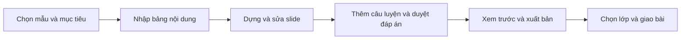

# Basic Design — Dịch vụ hỗ trợ giảng dạy

Ngày: 29/10/2026. Trạng thái: đang triển khai theo lát; tiến độ ghi ở [đối chiếu source](../source-alignment.md). Phạm vi theo yêu cầu người dùng: nhiều giáo viên, hỗ trợ mở rộng nhiều môn/ngôn ngữ, ưu tiên dạy tiếng Trung cho người Việt (Việt–Trung), lớp học riêng, Google Meet bên ngoài, học liệu chia sẻ và chuyển bài scan.

## Đánh giá hướng sản phẩm

Hướng này phù hợp với nền hiện có: editor và renderer dùng chung dữ liệu; lớp/bài giao/điểm/nhắc học có thể tái sử dụng. Phần khó nhất là quyền giữa giáo viên và chất lượng nhập scan. Ưu tiên vận hành được một lớp trước, sau đó thêm chia sẻ và OCR. Không cần dựng hạ tầng video để đạt mục tiêu dạy online.

Google Meet hỗ trợ trình bày tab/cửa sổ theo [hướng dẫn chính thức](https://support.google.com/meet/answer/9308856?hl=en). Chọn tab slide cho học sinh xem; cửa sổ presenter/đáp án và dashboard giữ riêng. Kiểm tra âm thanh trên thiết bị thật. Link Meet không thay thế kiểm tra quyền lớp của Reng; quyền vào cuộc gọi do Google Meet quản lý.

## Phân biệt với mã nguồn hiện tại

| Hạng mục | Có thể tái sử dụng | Phần cần bổ sung |
|---|---|---|
| Tài khoản | Auth, xác minh email, role phía server | Tự đăng ký giáo viên; khả năng vừa học vừa dạy |
| Lớp | Chủ lớp, mã lớp, thành viên, bài giao | Giới hạn chỗ, link Meet, UI mời học sinh |
| Học liệu | Nháp, xuất bản, snapshot, trình chiếu, PDF | Ngôn ngữ Trung, chia sẻ phiên bản và sao chép |
| Bài tập | Choice/fill, server chấm, policy test, báo cáo | Upload scan, duyệt OCR; chấm tay chưa có |
| Nhắc học | Tùy chọn opt-in, lịch, job email | Phạm vi/quota theo giáo viên; nghiệm thu gửi thật |

Không đổi nhãn trạng thái của checklist cũ thành PASS cho chức năng mới.

## Luồng 1 — Giáo viên mở lớp 10 học sinh

1. Chọn đăng ký giáo viên, xác minh email và chấp nhận điều kiện dùng dịch vụ. Server kiểm tra trước khi bật khả năng dạy. Người đã là học sinh có thể bổ sung khả năng dạy mà không mất bài cũ.
2. Tạo lớp: tên, ngôn ngữ, sức chứa 10, ngưỡng đạt, link Meet tùy chọn. Mã lớp/lời mời là quyền xin vào lớp, không cấp quyền quản trị.
3. Mười học sinh có email xác minh vào lớp; mỗi người chỉ chiếm một chỗ. Người thứ 11 thấy lớp đã đầy; join lại cùng tài khoản trả thành công, không chiếm thêm chỗ. Danh sách chờ chưa làm bản đầu.
4. Giáo viên thu hồi/đổi mã, đóng nhận thành viên, cho học sinh rời lớp; thành viên đã rời không đọc được tài nguyên riêng mới. Không xóa lịch sử điểm để giải phóng chỗ.
5. Giáo viên gắn phiên bản bài vào lớp, đặt thời điểm mở, giao bài và hạn nộp. Học sinh chỉ xem tài nguyên được cấp cho lớp mình.

## Luồng 2 — Dạy qua Meet và học trên Reng

Trang lớp có lịch/link buổi học và học liệu. Bản đầu giáo viên nhập link Meet thủ công, mở bằng tab mới. Giáo viên chia sẻ tab slide, học sinh vừa nghe Meet vừa mở bài/bài tập trên Reng. Học sinh tự chuyển trang khi đọc lại; đồng bộ slide từ xa là chức năng riêng chưa cam kết. Không gửi ghi chú riêng vào slide chia sẻ, HTML học sinh, PDF hoặc dữ liệu phiên trình chiếu.

Sau giờ học, học sinh làm/nộp bài; hệ thống chấm khách quan và công bố theo policy. Dashboard phân biệt chưa nộp, đang làm, đã nộp, chờ chấm nếu dạng chấm tay được triển khai. Nhắc học dùng lựa chọn người nhận; giáo viên không tự bật đồng ý nhận email thay học sinh.

## Luồng 3 — Chia sẻ giữa giáo viên

Chủ bài chọn phiên bản đã xuất bản, giáo viên nhận (tài khoản đã xác minh) và quyền `view` hoặc `copy`. Mặc định riêng tư, không có chợ học liệu công khai trong bản đầu. Người nhận xem trước bài được chia sẻ; quyền copy cho phép tạo một bài mới sở hữu bởi người nhận và sửa độc lập. Quyền view chưa cho gắn bài gốc vào lớp của người nhận; muốn dạy lớp mình cần copy.

Gói chia sẻ chỉ gồm slide, nội dung tham chiếu và media được phép sử dụng. Không kèm học sinh, báo cáo, nháp, ghi chú giáo viên hay câu test riêng. Câu quiz trong slide là câu luyện đã công khai cho người nhận, không được coi là đề bí mật. Bản sao giữ thông tin tác giả/nguồn/điều kiện dùng; người nhận không được chia sẻ tiếp trừ khi quyền nguồn cho phép.

Thu hồi ngăn xem/sao chép mới từ nguồn; không tự xóa bản sao đã được cấp hợp lệ hay thay đổi bài đã giao. Hệ thống phải giải thích điều này trước khi cấp quyền copy. Gỡ nội dung vi phạm là luồng vận hành riêng, có audit và thông báo, không hứa thu hồi được mọi tệp đã tải.

## Luồng 4 — Từ ảnh bài tập sang trang tương tác

1. Giáo viên tải ảnh JPG/PNG hoặc PDF scan, xác nhận có quyền dùng. Bản đầu đề xuất tối đa 10 trang, 20 MB/job, cấu hình lại được sau thử nghiệm.
2. Hệ thống kiểm tra tệp, hiển thị trang gốc và chạy nhận dạng ở nền. Tiến trình/lỗi rõ ràng; giáo viên có thể tiếp tục công việc khác.
3. Editor hiển thị ảnh cạnh câu nhận dạng, vùng ảnh nguồn và phần còn thiếu. Giáo viên sửa câu hỏi, lựa chọn, thứ tự, ký hiệu, điểm và đáp án; kiểm tra chữ Hán, pinyin/thanh điệu, kana/furigana riêng.
4. Bản đầu hỗ trợ chữ in và câu choice/fill. Bảng phức tạp, chữ viết tay, nối hình, tự luận có thể giữ làm hình minh họa hoặc nhập tay; không báo đã tự chấm được.
5. Chỉ câu được giáo viên duyệt và đủ đáp án mới xuất bản được. Chuyển thành schema bài tập hiện có, sau đó giao cho lớp bằng luồng thông thường. OCR không tự tạo assignment.

Hai mức giá trị: ảnh trong slide giúp chiếu/đọc; bài tương tác cần dữ liệu câu hỏi và đáp án. Chỉ nhúng ảnh không đủ để chấm tự động. AI có thể gợi ý cấu trúc/đáp án nhưng mọi gợi ý phải được xác nhận, không lấy độ tin cậy OCR làm bằng chứng đáp án đúng.

## Màn hình dự kiến

| Mã | Màn hình/route dự kiến | Hành vi chính |
|---|---|---|
| SV01 | `/sign-up/teacher` | Đăng ký và trạng thái xác minh/khả năng dạy |
| SV02 | `/teach/classes/[id]` (form cài đặt lớp) | Sức chứa, ngôn ngữ, link Meet, mã lớp |
| SV03 | Trang lớp học sinh hiện có | Link buổi học, slide đã mở, bài và tiến độ |
| SV04 | `/teach/library` | Bài của tôi/được chia sẻ, ngôn ngữ và nguồn |
| SV05 | `/teach/lessons/[id]/sharing` | Chọn version, người nhận, quyền, thu hồi |
| SV06 | `/teach/imports`, `/teach/imports/[id]` | Upload, tiến trình, ảnh và câu draft, duyệt |
| SV08 | `/admin`, `/admin/teachers`, `/admin/activity` | Quản trị: tổng quan, duyệt/tạm dừng giáo viên, hạn thuê, cài đặt duyệt, nhật ký |
| SV09 | `/for-teachers` | Trang giới thiệu công khai cho giáo viên, tối ưu SEO |
| SV10 | `/guide` | Hướng dẫn sử dụng công khai cho giáo viên, học viên và quản trị viên; link ở thanh đầu trang, chân trang, trang Giảng dạy và Lớp của tôi |

SV01–SV05, SV08, SV09 và SV10 đã có; kích hoạt giảng dạy cho tài khoản đang đăng nhập ở `/teach/start`, thư viện chia sẻ ở `/teach/library`, cấp/thu hồi quyền ở `/teach/lessons/[id]/sharing`. SV06 (scan) là route đề xuất, chưa tồn tại. UI 360px; review scan trên desktop có hai cột, mobile chuyển tab ảnh/câu. Bảo toàn sửa tay khi retry nhận dạng.

## Ngôn ngữ và chấm điểm

MVP tập trung Việt–Trung: học sinh Việt Nam học tiếng Trung, giao diện/hướng dẫn/nghĩa bằng tiếng Việt, nội dung học có chữ Hán, pinyin và audio tiếng Trung. Không yêu cầu giáo viên nhập một khóa tiếng Nhật để nghiệm thu dịch vụ. Tiếng Việt ở đây là ngôn ngữ hướng dẫn, không mặc định một khóa dạy tiếng Việt riêng. Các môn và ngôn ngữ khác mở sau theo nhu cầu.

Tiếng Nhật giữ kana, kanji, wanakana và quy tắc hiện tại. Tiếng Trung cần metadata `zh-Hans`/`zh-Hant`, pinyin và chế độ nhập Unicode/IME; không ép wanakana, không tự đổi giản/phồn hoặc bỏ thanh điệu. Giáo viên khai báo đáp án tương đương. Bộ font/TTS đúng locale, module kana/JLPT chỉ xuất hiện cho tiếng Nhật. UI quản lý ban đầu vẫn tiếng Việt.

Tự luận/ảnh bài làm cần chấm tay và trạng thái/điểm riêng trước khi bật; ngoài MVP scan choice/fill. Không tự coi nội dung chưa hỗ trợ là sai hoặc điểm 0.

## Thứ tự giao và tiêu chí thử nghiệm

A: onboarding giáo viên + cách ly dữ liệu + lớp có sức chứa/link Meet. B1: luồng soạn Việt–Trung theo mẫu và dạy thử một bài nhập môn. B2: chia sẻ/copy version và dùng lại bài, giữ tương thích nội dung Nhật hiện có. C: upload ảnh để xem, sau đó OCR choice/fill có duyệt. D: chấm tay và mở rộng loại scan theo dữ liệu thực tế. Chưa triển khai thu phí.

Thử với hai giáo viên tiếng Trung dạy người Việt, một lớp 10 học sinh, một lớp khác để kiểm tra vượt quyền; kiểm tra hồi quy riêng với dữ liệu Nhật hiện có; dùng bộ scan được phép sử dụng. Đo thời gian nhập tay và thời gian sửa kết quả scan, tỷ lệ câu cần sửa, lỗi đáp án, chi phí/trang và số job lỗi. Chỉ mở OCR rộng khi giúp giáo viên tiết kiệm thời gian và mọi câu xuất bản được duyệt. Testcase chi tiết ở [checklist dịch vụ](../testing/teaching-service.md).

## Luồng 5 — Giáo viên tự soạn bài theo mẫu

Đặc tả thao tác đầy đủ tại [biên soạn nội dung](../content-authoring.md). Đã có bản local (wizard 5 bước, dựng slide từ bảng, xác nhận đáp án, xuất bản riêng tư); editor chi tiết cũ vẫn dùng cho bài tiếng Nhật. Chưa có TTS web, dùng lại/sao chép bài và thử với giáo viên thật.

Giáo viên soạn chuyên môn; Reng cung cấp bố cục và bộ bài minh họa có người chuyên môn duyệt. Bộ mẫu đầu gồm buổi đầu làm quen, từ mới, hội thoại và ôn tập. Có dùng lại bài của mình và copy bài được chia sẻ đúng quyền; không cần upload scan mới tạo bài được.

Màn hình soạn mới (SV07, mở rộng trang tạo/sửa bài hiện có) có 5 bước với nhãn tiếng Việt, nút quay lại/tiếp tục, lưu nháp ở mọi bước, không ép hoàn thành trong một phiên. Bảng nội dung có chữ Hán/pinyin/nghĩa Việt/ví dụ, hỗ trợ dán Excel. Mã kỹ thuật ẩn khỏi luồng cơ bản. Desktop xem nội dung cạnh preview, mobile chuyển qua lại mà không mất dữ liệu. Giáo viên vẫn có thể mở phần chỉnh slide chi tiết.

Mẫu khởi đầu đi theo mục tiêu nhỏ và thứ tự từ dễ đến khó; bài đầu được bỏ phần ôn cũ. Bước luyện tập gợi ý khung choice/fill nhưng giáo viên duyệt đáp án. Bước cuối tách lưu nháp, xuất bản và giao lớp; chỉ trình chiếu thì không cần giao bài. Khi dùng lại/chuyển mẫu/dựng lại phải thấy thay đổi trước xác nhận, không ghi đè sửa tay.

Trước OCR, thử trọn luồng với một giáo viên, một bài nhập môn Việt–Trung và lớp thực tế. Mục tiêu dưới 30 phút khi đã chuẩn bị nội dung; ghi thời gian và điểm vướng, chưa coi là đạt trước đo. Tiêu chí hồi quy quyền nhiều giáo viên vẫn theo bộ thử dịch vụ chung.

## Luồng 6 — Dạy tiếng Nhật theo trình tự Minna no Nihongo (pilot, đã có bản local)

Cập nhật 29/10/2026 theo yêu cầu người dùng: pilot ưu tiên dạy tiếng Nhật cho người Việt bằng slide đi theo trình tự bài Minna no Nihongo, không mở rộng thêm tính năng ngoài luồng dạy học. Luồng Việt–Trung vẫn chạy.

1. Giáo viên có tài khoản đã xác minh và quyền dạy (tự đăng ký có quản trị viên duyệt, hoặc cấp trên Supabase local bằng `npm run seed:local -- --email … --name …`).
2. Ở `/teach/lessons/new`, giáo viên tạo bài 11 từ bài mẫu tự biên soạn, kiểm tra/sửa trong editor rồi xuất bản; bài vẫn riêng tư cho lớp. Bài sau dùng bản sao hoặc soạn mới.
3. Tạo lớp (mặc định tiếng Nhật), gắn phiên bản bài, giao luyện tập. Trong buổi Meet, giáo viên chiếu slide theo nhịp Minna: từ vựng → bảng đếm → mẫu câu → ví dụ → luyện thay thế (ẩn câu mẫu, bấm hiện từng hàng) → câu hỏi → hội thoại (ẩn nghĩa từng lượt); presenter giữ ghi chú riêng.
4. Học viên tự đăng ký, xác minh email, vào lớp bằng mã; đọc bài có furigana, hội thoại, bảng; ôn bằng slide/flashcard; làm bài, xem điểm và giải thích; giáo viên xem báo cáo lớp.
5. Bài luyện hằng ngày (tùy chọn theo lớp): giáo viên chọn 5/7/10/15 câu; mỗi sáng 6:00 giờ Việt Nam Reng tự giao một bài luyện tập từ bài học mới nhất đã mở cho lớp, hạn 23:59 cùng ngày, nộp muộn vẫn được, tối đa 3 lượt, xem giải thích ngay. Câu đổi mỗi ngày, ưu tiên câu chưa xuất hiện trong 14 ngày gần nhất; câu sai vào sổ lỗi và lịch ôn tập như bài thường. Nút "Giao bài hôm nay ngay" tạo bài của ngày khi cần; mỗi lớp chỉ có một bài cho mỗi ngày. Báo cáo chỉ tính bài được giao sau khi học viên vào lớp.

Nội dung mẫu không sao chép văn bản, tranh hay audio của sách; chỉ đi theo chủ điểm và trình tự bài. Chi tiết thao tác ở [biên soạn](../content-authoring.md), kết quả kiểm thử ở [nghiệm thu](../testing/teaching-service.md).

## Ma trận quyền sản phẩm và vòng đời

| Người dùng | Học liệu | Lớp và kết quả |
|---|---|---|
| Khách | Chỉ bản public đã xuất bản, không có nháp/notes/test | Không vào danh sách lớp riêng hoặc đọc thông tin học sinh |
| Học sinh đang học | Phiên bản lớp được cấp quyền và đã mở, câu luyện đúng policy | Làm/nộp/xem kết quả của mình; không đọc email/bài nộp người khác |
| Chủ lớp/chủ bài | Soạn và xuất bản bài mình; chia sẻ version có quyền dùng | Quản lý lớp mình, gắn bài mình sở hữu, theo dõi/chấm theo chức năng đã hỗ trợ |
| Giáo viên được share view | Đọc đúng version đã lọc, không notes/test/draft; chưa gắn vào lớp mình | Không có quyền nào trên học sinh/lớp nguồn |
| Giáo viên được share copy | Tạo draft thuộc mình, giữ nguồn/quyền media, duyệt rồi xuất bản riêng | Giao bản đã copy cho lớp mình, không truy cập lớp gốc |
| Quản trị viên nền tảng | Không đọc nháp, ghi chú riêng hay bài riêng của giáo viên; xem nhật ký thao tác | Duyệt/tạm dừng giáo viên, ghi hạn thuê, xem số liệu tổng hợp (số lớp, học viên, bài nộp); không đọc bài nộp hay email học viên. Quyền cấp bằng SQL, tài khoản giáo viên không tự có |

Nháp → xuất bản → gắn lớp/giao bài là các thao tác riêng. Lưu trữ bài không xóa snapshot/bài nộp cũ; đóng bài giao phải cảnh báo lượt đang làm sẽ không nộp được theo hợp đồng hiện tại. Bản sao và bài giao đã tạo không tự đổi theo bài nguồn. Trường hợp rời lớp/đổi mã/ngừng dạy/thu hồi share được xử lý ở phạm vi tương ứng, không cascade xóa lịch sử.

Đăng ký giáo viên tự phục vụ mặc định kích hoạt sau xác minh email, điều khoản và kiểm tra lạm dụng; vận hành xử lý pending/suspended ngoại lệ. Khả năng học và dạy độc lập; không bắt tạo hai tài khoản. Không coi xác minh email là xác nhận năng lực chuyên môn.
